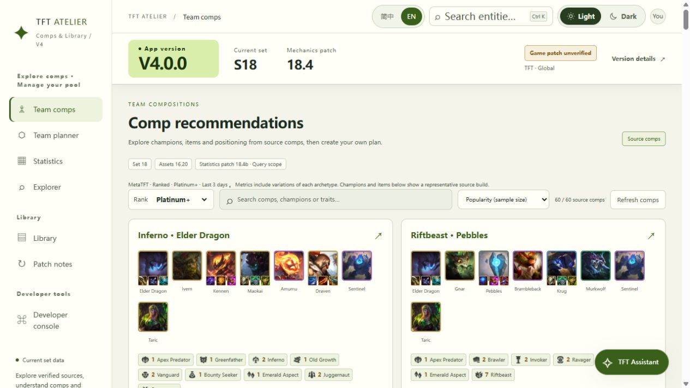
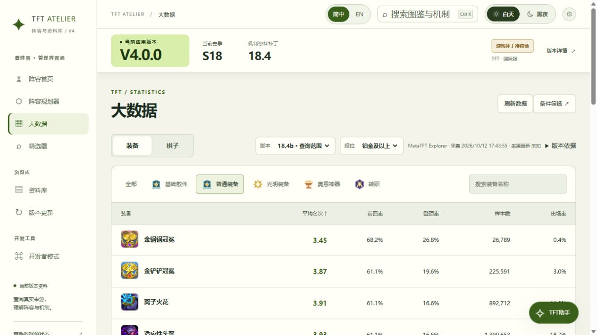
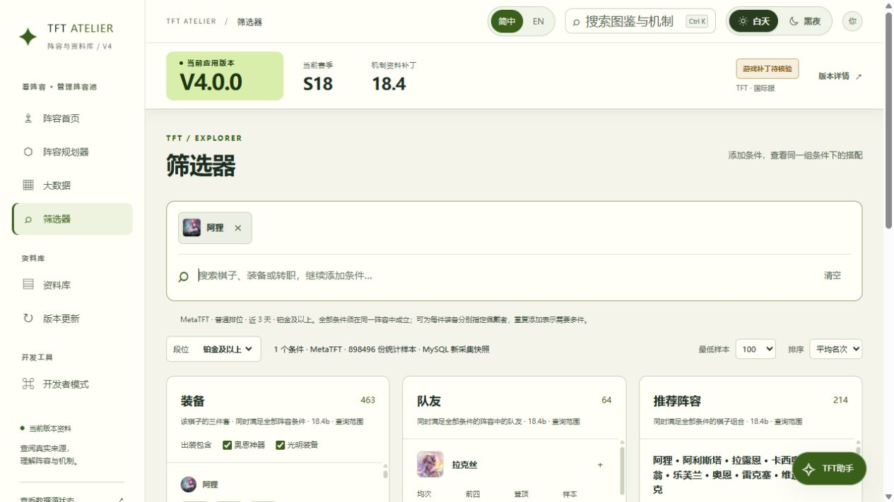
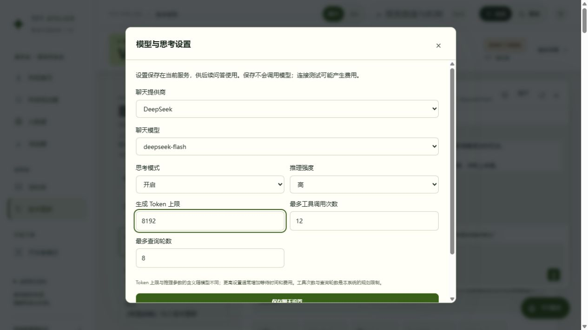
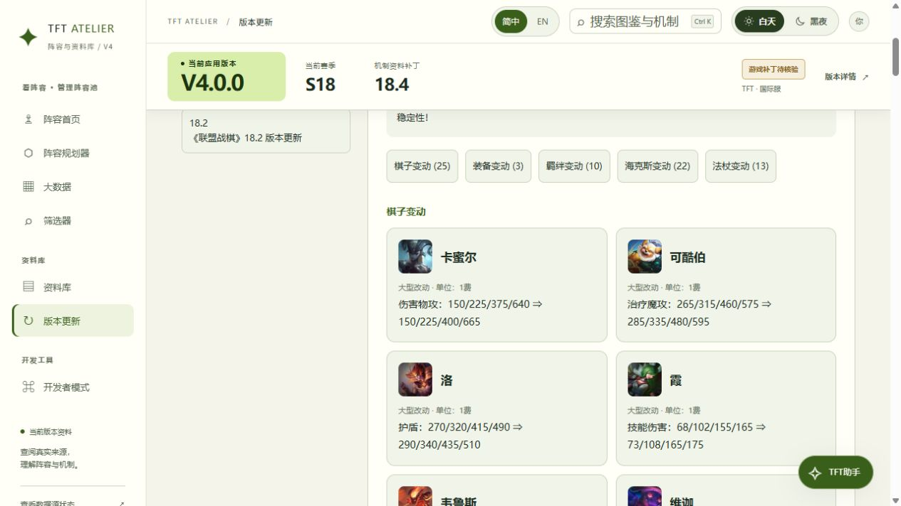
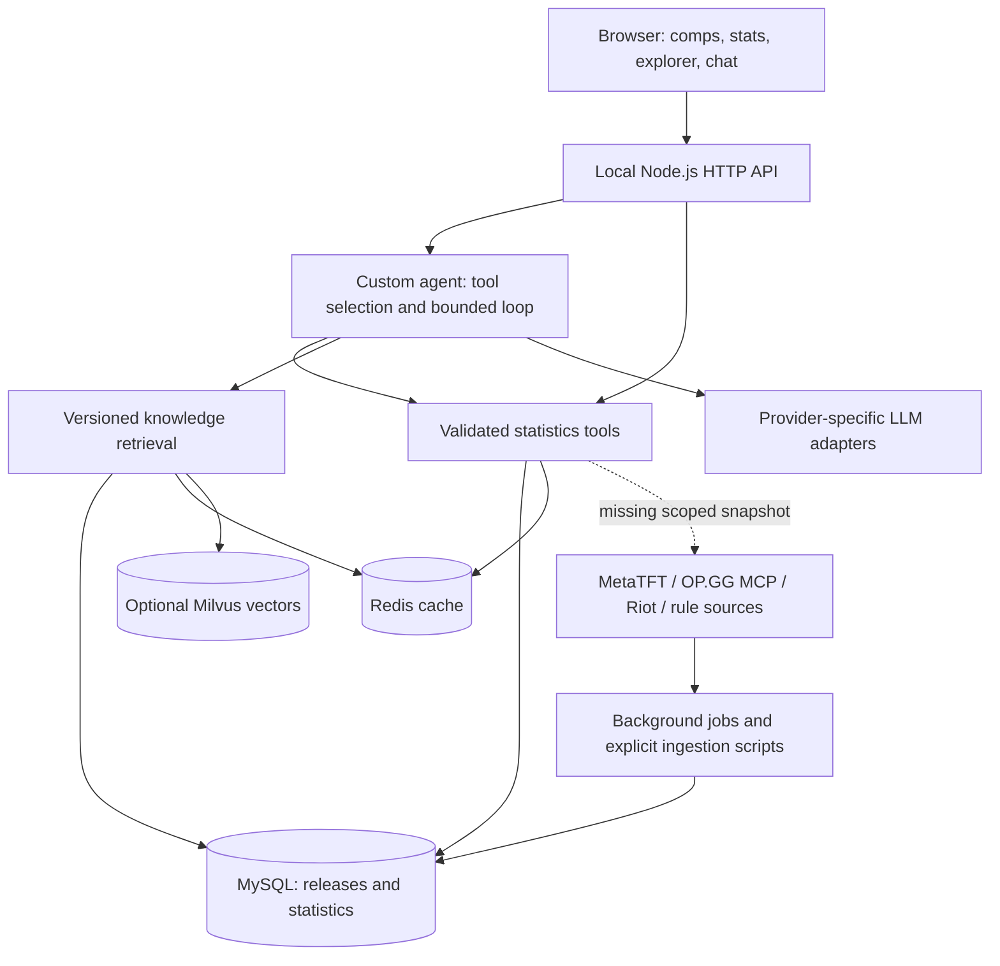

<div align="center">

# TFT Atelier
### A source-backed Teamfight Tactics assistant and research workbench

**English** · [简体中文](README.zh-CN.md)

`V4.0.0 · Research beta` · `Node.js` · `MySQL` · `Redis` · `Milvus` · `Function calling`

[Quick start](#quick-start) · [Features](#features) · [Architecture](docs/ARCHITECTURE.md) · [Setup guide](docs/SETUP.md)

</div>



Ask questions about comps, item builds and item holders, inspect the same statistics in the UI, and trace answers back to versioned data. TFT Atelier combines a custom tool-calling agent, structured statistics and an optional hybrid knowledge retriever.

**This is a local, single-user research application.** It does not play the game, watch live matches, train itself or guarantee optimal decisions. The screenshot shows one installation's synchronized data; a new clone does not include that installation's MySQL database or Milvus vectors.

## Features

| Area | What is implemented |
| --- | --- |
| Natural-language queries | Tool-based routing to comps, champion/item rankings, complete builds, holders and supported condition queries; follow-up query changes; grounded result cards |
| Statistics explorer | Champion + item + individual holder conditions; sample thresholds, ranking and 12 rank scopes; artifact and radiant item controls |
| Comp research | MetaTFT comp-family statistics with source representative lineups; never presented as exact joint build statistics |
| Knowledge library | Champion/item/trait/augment/mechanic references, recipes, rule tables and 191 Chinese community terminology entries |
| RAG | Lexical retrieval, optional Milvus dense retrieval, reciprocal rank fusion, patch/eligibility filters and evidence links |
| Model controls | DeepSeek, Qwen, GPT, Claude and Kimi adapters; model-specific reasoning controls; independent embedding presets |
| Updates | Configurable statistics jobs (daily by default), official patch-note checks and illustrated change categories |
| Planning & diagnostics | Local comp notes, board editing, team-code import/export, source inventory, retrieval diagnostics and tool traces |
| Presentation | Simplified Chinese / English UI, light/dark modes and font controls; source translations may be incomplete |

### Explore statistics with explicit scope



Statistics retain their source, requested patch, rank scope, sampling window and sample size. Unknown source fields remain unknown. OP.GG reference snapshots and optional Riot match records are separate; their rates are not averaged with MetaTFT.

### Build a query through the interface or the assistant



Example prompts (results depend on your synchronized patch and samples):

- “Recommend comps with 1-cost or 2-cost carries.”
- “Who can hold Silvermere Dawn?”
- “Show Ahri builds, require Jeweled Gauntlet, and exclude Bloodthirster.”
- “Now change the rank to Diamond and raise the sample threshold to 500.”

The model maps these requests to validated tool arguments. Unsupported filters and empty results are reported explicitly. A low-cost carry filter alone does not prove that the source labels a comp as a reroll strategy.

### Choose a model and its supported reasoning controls



Open **TFT Assistant → ⚙**. Reasoning effort, thinking budgets and on/off switches are shown only for registered models that support them. Tool-call and query-round limits are application controls. Saving does not call a paid API; credentials remain server-side. Embedding changes require a matching index, not a silent reuse of incompatible vectors.

### Read illustrated patch notes



Official announcements are stored with their source links. The application matches changed entities against the catalog to render images and text. Missing matches remain visible as missing assets instead of fabricated icons. Patch notes and statistics have independent update schedules.

## Quick start

**Recommended:** Docker Desktop with Linux containers, or Docker Engine + Compose V2. The cross-platform initializer also requires Node.js 22+; the Windows launcher can generate configuration without host Node.js. Docker builds need access to the image registry and npm. Reserve enough resources for your chosen services; no minimum-memory benchmark is claimed.

```sh
git clone https://github.com/huangtaozhou33-collab/tft-evidence-workbench.git
cd tft-evidence-workbench
node scripts/init-docker-env.mjs
docker compose --env-file .env.docker up --build -d --wait
```

Open **http://127.0.0.1:3001**. The initializer creates random local database passwords and blank model keys; it does not overwrite an existing configuration. First boot migrates MySQL and imports the bundled season seed.

Windows alternative:

```powershell
.\start-docker.ps1
# Optional vector infrastructure:
.\start-docker.ps1 -Rag
```

**First-run checklist**

1. Browse the library and planner without a model key.
2. In **Developer mode → Statistics updates**, start the required MetaTFT jobs. A new database does not contain the developer's latest statistics; scheduled jobs default to the next daily run.
3. Configure a chat provider in `.env.docker`, recreate the app, then select its model in the assistant. See [configuration and startup](docs/SETUP.md).
4. For semantic retrieval, start the RAG profile, configure embeddings and explicitly build the index. This can incur embedding charges.

For a lightweight **local JSON development mode**:

```sh
npm ci
npm start
```

Open http://127.0.0.1:3000. This mode is useful for catalog/UI development; it does not provide the full MySQL statistics and scheduling experience. No frontend build is required.

## Architecture



The agent orchestration is custom JavaScript, not LangChain/LangGraph. **Function calling is used by the assistant. MCP is used by the OP.GG ingestion client**, not as a general public MCP server. The model does not receive arbitrary SQL access. See the [complete architecture](docs/ARCHITECTURE.md) for modules, data boundaries, sequences and failure behavior.

## Development & validation

```sh
npm ci
npm test
npm run db:dry-run
```

The offline suite currently has **476 passing tests** in the local verification run. `pretest` restores missing historical test fixtures without overwriting existing cache files. These are test records, not live match samples. GitHub Actions runs offline tests and seed validation; model keys are not required. Cloud CI status is independent of local results.

`npm run check:ai` and `npm run rag:index` are **explicit live-provider operations** and may incur costs. They are not part of ordinary CI. Cross-provider paid generation has not been fully acceptance-tested. See [release verification](docs/RELEASE_READINESS.md).

## Project map

```text
public/             Browser UI, localization, shared query models and cards
server/             HTTP API, agent, provider adapters, domain tools
  knowledge/        Scoped lexical/vector retrieval and glossary
  metatft/          Dataset adapters and conditional statistics
  riot/             Optional match collection and SQL queries
  storage/          MySQL migrations, releases and persistence
scripts/            Config initialization, ingestion, indexing and checks
data/               Catalog, attributed reference data and compressed seed
tests/              Offline regression tests and reproducible fixtures
docs/               Bilingual guides, screenshots and engineering records
runtime/            Local non-secret model preferences (ignored by Git)
```

## Scope and roadmap

Implemented: the query assistant, statistics UI, versioned knowledge, provider settings and local update jobs. Not implemented: live screen recognition, automatic gameplay, a professional-player video decision corpus, fine-tuning, self-improvement, public multi-tenant authentication or a general MCP server. Existing research notes are proposals or dated evidence, not promises of shipped features.

MetaTFT composite trait filters are currently unsupported; trait tier rankings are a separate view. Upstream APIs may change or be unavailable. Numerical results are observations, not causal recommendations. Stale or cross-patch data must not masquerade as current evidence.

## Documentation

- [Architecture](docs/ARCHITECTURE.md) / [架构中文版](docs/ARCHITECTURE.zh-CN.md)
- [Setup, models, data and troubleshooting](docs/SETUP.md) / [启动中文版](docs/SETUP.zh-CN.md)
- [Model parameter reference (Chinese)](docs/MODEL_CONFIGURATION.md)
- [Documentation index](docs/PROJECT_GUIDE.md)
- [Release verification](docs/RELEASE_READINESS.md)
- [Engineering lessons](docs/ENGINEERING_LESSONS.md)
- [Third-party data notices](THIRD_PARTY_NOTICES.md)

## Attribution and license status

This project is not affiliated with or endorsed by Riot Games, MetaTFT or OP.GG. Source references are retained. No open-source code license has been selected for this initial private snapshot; third-party data and artwork have separate rights. Do not infer redistribution permission from repository visibility. See [notices](THIRD_PARTY_NOTICES.md).

README organization was informed by [Dify](https://github.com/langgenius/dify), [RAGFlow](https://github.com/infiniflow/ragflow) and [Flowise](https://github.com/FlowiseAI/Flowise): a visual overview, separate quick start, feature boundaries and linked technical documentation. This project does not claim to use their runtimes.
