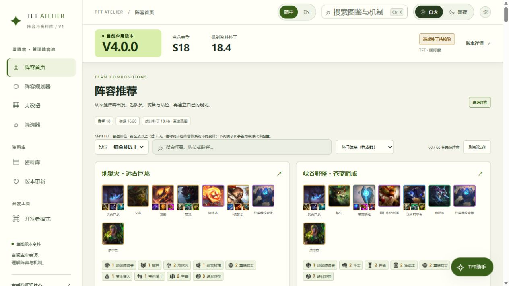
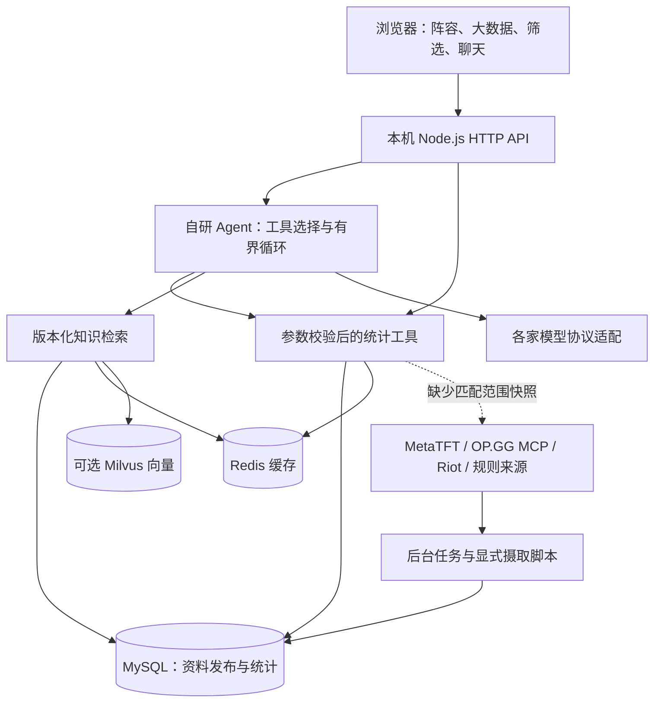

<div align="center">

# TFT Atelier · 云顶资料与问答工作台
### 把阵容、装备统计与版本知识接到同一个可追溯的助手

[English](README.md) · **简体中文**

`V4.0.0 · 研究预览版` · `Node.js` · `MySQL` · `Redis` · `Milvus` · `Function calling`

[快速启动](#快速启动) · [功能介绍](#功能介绍) · [项目架构](docs/ARCHITECTURE.zh-CN.md) · [完整启动指南](docs/SETUP.zh-CN.md)

</div>



用自然语言查询阵容、装备和持有者，也能在页面中检查同一份统计。项目结合自研工具调用 Agent、结构化统计与可选的混合知识检索，让回答有实际数据与来源可查。

**当前面向单用户本机研究。** 不自动操作游戏、不识别实时对局、不自我训练，也不保证给出最优决策。截图来自已同步数据的实例；克隆仓库不会得到开发者的 MySQL 数据库和 Milvus 向量卷。

## 功能介绍

| 模块 | 已实现能力 |
| --- | --- |
| 自然语言查询 | 调用工具查询推荐阵容、棋子/装备榜、完整出装、持有者和受支持的组合条件；支持追问修改条件与图文结果卡片 |
| 组合筛选器 | 棋子、装备、每件装备的持有者组合；样本门槛、排序、12 种段位范围；奥恩神器和光明装备筛选 |
| 阵容研究 | MetaTFT 阵容体系统计及来源代表配置，不将代表配置冒充固定三件套联合样本 |
| 资料库 | 棋子、装备、羁绊、海克斯、法杖、配方和规则表，含 191 条中文社区术语 |
| RAG 检索 | 词法检索、可选 Milvus 向量召回、RRF 融合、版本与资格过滤、来源引用 |
| 模型设置 | DeepSeek、千问、GPT、Claude、Kimi 适配；按型号显示思考参数；Embedding 独立配置 |
| 数据更新 | 统计默认每天检查，可分任务设置周期；官方公告检测与图文分类展示 |
| 规划与诊断 | 本地阵容笔记、棋盘编辑、阵容码导入导出、资料清单、检索调试和工具调用记录 |
| 显示 | 顶栏简中/英文、明暗主题与字体设置；部分来源文本仍可能缺少翻译 |

### 大数据：统计口径能看清


保留来源、请求补丁、段位范围、统计窗口和样本量。来源未提供的字段保持未知；OP.GG 参考快照和可选 Riot 逐局数据单独保存，不与 MetaTFT 平均胜率或累加样本。

### 筛选器与助手：同一套查询能力


可以这样提问，实际结果取决于已同步版本和样本：

- “推荐核心是 1 费或 2 费的阵容。”
- “密银黎明给谁比较合适？”
- “看阿狸的出装，要有法爆，不要饮血。”
- “改成钻石段位，样本至少 500。”

模型把自然语言转成受校验的工具参数。不支持的条件会明确提示，没有结果也不会偷偷放宽条件。筛出低费核心，只能证明核心费用符合条件，不能直接证明来源把它标为赌狗阵容。

### 模型设置：不同厂家显示不同参数


打开 **TFT 助手 → ⚙**，选择模型并调整其支持的思考开关、强度或预算。工具调用次数与查询轮数属于项目控制项。保存不发起付费调用，密钥保留在服务端；更换 Embedding 后需建立匹配索引，不混用旧向量。

### 版本更新：图片与文字一起看


采集官方公告并保留原文链接，再把改动实体与资料库关联，按棋子、装备、羁绊、海克斯、法杖等分类显示。没有匹配到图片的条目保留缺失状态，不伪造图标。公告与统计分别调度。

## 快速启动

**推荐 Docker 数据库版。** 安装 Docker Desktop 并使用 Linux 容器，或 Docker Engine + Compose V2。跨平台初始化命令需要 Node.js 22+；Windows 启动脚本可直接生成配置。构建时需要访问镜像站与 npm。根据启用的服务预留资源，当前未给出经过基准测试的最低内存要求。

```sh
git clone https://github.com/huangtaozhou33-collab/TFT-.git tft-evidence-workbench
cd tft-evidence-workbench
node scripts/init-docker-env.mjs
docker compose --env-file .env.docker up --build -d --wait
```

打开 **http://127.0.0.1:3001**。初始化器生成随机数据库密码与空模型配置，不覆盖已有文件。首次启动自动执行迁移并导入赛季种子包。

Windows 也可执行：

```powershell
.\start-docker.ps1
# 如需向量基础设施：
.\start-docker.ps1 -Rag
```

**第一次使用**

1. 不填模型 Key，也能浏览资料与使用规划器。
2. 在 **开发者模式 → 统计自动更新** 运行需要的 MetaTFT 任务。新数据库没有开发者最新统计，默认自动任务安排在下一次每日周期。
3. 在 `.env.docker` 配置聊天服务并重新创建应用容器，然后在助手内选型号，详见 [启动与配置](docs/SETUP.zh-CN.md)。
4. 需要语义检索时再启用 RAG 服务，配置 Embedding 并显式建索引，此步骤可能产生费用。

只做图鉴和界面开发，可以使用轻量 **本地 JSON 模式**：

```sh
npm ci
npm start
```

访问 http://127.0.0.1:3000 。此入口不等于完整 MySQL 统计与调度体验，前端无需编译。

## 项目架构



Agent 编排为自研 JavaScript，未采用 LangChain/LangGraph。**助手使用 Function calling，OP.GG 摄取客户端使用 MCP**；项目没有对外提供通用 MCP Server，也不让模型执行任意 SQL。[完整架构](docs/ARCHITECTURE.zh-CN.md) 包含模块、数据边界、调用时序与故障行为。

## 开发与验证

```sh
npm ci
npm test
npm run db:dry-run
```

最近本地离线验收为 **476 项测试通过**。`pretest` 恢复缺失的历史测试夹具，不覆盖已有缓存；夹具记录数不是实际比赛场数。GitHub Actions 执行离线测试与种子校验，不需要模型 Key。云端 CI 是否通过应以实际运行结果为准。

`npm run check:ai`、`npm run rag:index` 是显式真实提供商操作，可能收费，不在普通 CI 中执行。各家模型的付费生成尚未全部验收。详见 [发布验收](docs/RELEASE_READINESS.md)。

## 文件结构

```text
public/             浏览器界面、语言包、共享查询模型、图文卡片
server/             HTTP、Agent、模型适配、领域工具
  knowledge/        版本化词法/向量检索与术语库
  metatft/          数据集适配与组合统计
  riot/             可选逐局采集与 SQL 查询
  storage/          MySQL 迁移、发布与持久化
scripts/            初始化、摄取、索引和检查
data/               图鉴、带来源资料、压缩种子包
tests/              离线测试与可复现夹具
docs/               双语指南、截图、工程记录
runtime/            本地模型选择（Git 忽略，不存密钥）
```

## 能力边界与后续方向

已交付查询助手、统计页面、版本知识、模型设置和本机更新任务。尚未实现实时画面识别、自动操作游戏、职业选手视频决策库、微调、自进化、公网多用户权限和通用 MCP Server。历史研究文档是计划或当时的验收记录，不能当作当前已完成能力。

MetaTFT 组合筛选目前不支持羁绊条件，羁绊档位榜是独立视图。上游接口可能变化或不可用；统计体现样本中的表现，不证明因果或最优策略。旧数据、跨补丁数据不能冒充当前版本证据。

## 文档导航

- [完整项目架构](docs/ARCHITECTURE.zh-CN.md) / [English](docs/ARCHITECTURE.md)
- [启动、模型、数据与排错](docs/SETUP.zh-CN.md) / [English](docs/SETUP.md)
- [模型参数说明](docs/MODEL_CONFIGURATION.md)
- [全部文档索引](docs/PROJECT_GUIDE.md)
- [发布验收](docs/RELEASE_READINESS.md)
- [工程学习记录](docs/ENGINEERING_LESSONS.md)
- [第三方数据说明](THIRD_PARTY_NOTICES.md)

## 来源与许可证状态

项目与 Riot Games、MetaTFT、OP.GG 无隶属或背书关系，保留原资料来源。本次私有版本尚未选择开源代码许可证，第三方数据和图片另有权利归属；仓库可见性不代表已经获得再分发许可。详见 [说明](THIRD_PARTY_NOTICES.md)。

文档组织参考 [Dify](https://github.com/langgenius/dify)、[RAGFlow](https://github.com/infiniflow/ragflow)、[Flowise](https://github.com/FlowiseAI/Flowise) 的图文概览、快速启动、能力边界与技术文档导航，没有声称采用其运行框架。
