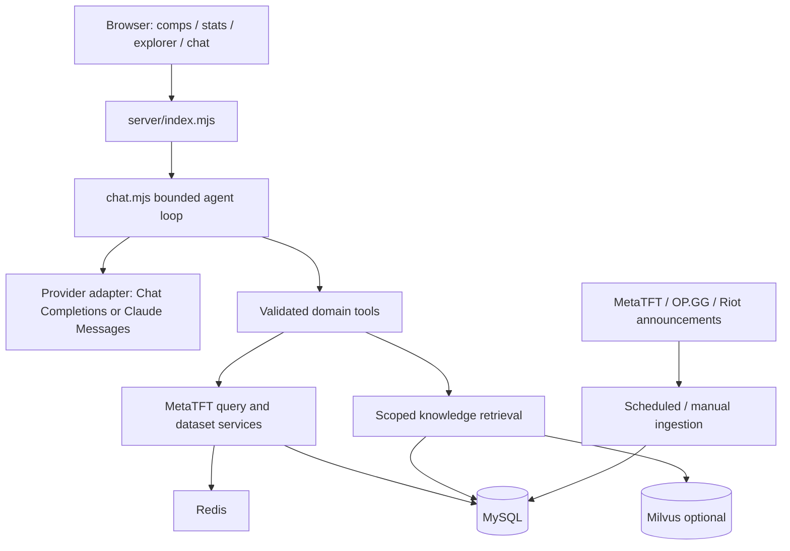

# Architecture — V4

[简体中文](ARCHITECTURE.zh-CN.md) · [Home](../README.md)

## Runtime

This is a custom bounded tool-calling agent, served by Node.js HTTP with a vanilla JavaScript frontend. It does not use LangChain or a multi-agent framework. MySQL stores authoritative records; Redis accelerates reads; Milvus is an optional knowledge index. Docker Compose provides a local deployment.

## Request and evidence flow

1. Resolve intent and catalog/glossary entities, preserving ambiguous aliases.
2. The model selects typed tools such as `search_glossary`, `search_catalog`, `query_tft_stats` or clarification. It does not receive unrestricted SQL access.
3. Validate view, IDs, rank, sample threshold and complete conditions. Champion, item and per-item holder conditions describe one matching composition; repeated items require multiple copies.
4. Execute the same statistics services used by the website. Keep source, patch attribution, rank and sample scope with the result.
5. Return evidence-backed text and structured cards; bound rounds, tool calls and time. Empty results and unsupported filters remain explicit.

Follow-up questions can amend query conditions. This behavior still depends on the model and available context; tool validation limits errors but does not prove strategic correctness. Low-cost core filters use source core-unit information, not a universal verified reroll label.

## Persistence boundaries

| Layer | Responsibility | Important boundary |
|---|---|---|
| MySQL reference records | Releases, entities, documents, chunks, source capabilities, attribution | Source-stated patch and inferred attribution are different |
| MySQL statistics | MetaTFT datasets/rows and conditional snapshots/rows; separate Riot raw matches | Never add overlapping provider sample counts or average their rates |
| MySQL operations | Index jobs, statistics jobs/runs, patch monitor/articles | Job completion is different from complete upstream coverage |
| Redis | Query/retrieval caches and coordination | Rebuildable; not the system of record |
| Milvus | Vectors for eligible knowledge chunks | Vector count is not document or statistics sample count |
| Runtime JSON volume | Non-secret model selection and parameters | API keys stay in server environment |
| Browser storage | Personal notes and presentation preferences | Per-origin local data, not cloud-synchronized accounts |

Schema evolution lives in `server/storage/schema*.sql`; the migration runner tracks versions/checksums. Do not omit these files from a release. The compressed seed is a reference/bootstrap snapshot, not a copy of the author's development database or a ready-built vector index.

## Retrieval

`server/knowledge/service.mjs` filters eligible season/patch knowledge and general terminology, retrieves lexical matches and optional dense matches, and combines rankings. Exact terminology spans receive priority. Embedding provider, endpoint, model, dimensions and index profile must agree. An unavailable or mismatched vector index falls back to lexical retrieval rather than claiming vector coverage. Similarity scores are not probabilities of truth.

Live statistics stay in structured tools. Do not repeatedly embed changing win rates as teaching knowledge. A professional-video decision corpus and its review pipeline remain future work.

## Ingestion and consistency

Statistics jobs default to daily checks and can be configured in developer mode. Source fingerprints avoid unnecessary versions; failures retain usable previous data. Publication is atomic per dataset, **not one transaction across all sources and jobs**. Some missing conditional datasets still require an upstream request, so not every first query is offline or instant.

Patch monitoring stores official article references and resolves entity pictures against the catalog. Missing assets must retain a fallback. Simplified Chinese announcements are converted from official Traditional Chinese and mapped to local entity names; they are not a claim of an official mainland-China announcement.

OP.GG's ingestion integration is an MCP client. The assistant's function-calling tools are internal application tools; the project does not expose a general public MCP server.

## Model and security boundaries

`model-providers.mjs` adapts provider-specific capabilities; `model-settings.mjs` validates and persists preferences. Claude uses native Messages semantics; other supported providers use compatible request formats with model-specific settings. Embedding selection is independent and requires reindexing after incompatible changes.

The deployment is a local single-user research app. Loopback bindings and request guards do not replace authentication, authorization, TLS, quotas or tenant isolation for a public service. Provider secrets are never intended to be returned to the browser. Paid-provider acceptance is separate from offline tests.

See [setup](SETUP.md), [model settings](MODEL_CONFIGURATION.md) and [verification limits](RELEASE_READINESS.md).
