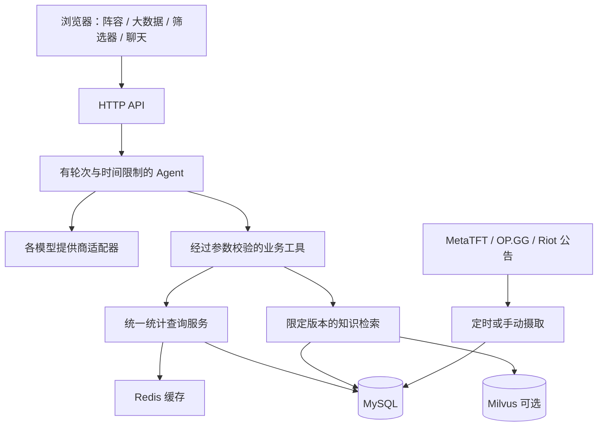

# 项目架构 — V4

[English](ARCHITECTURE.md) · [首页](../README.zh-CN.md)

## 运行结构

项目使用 Node.js 原生 HTTP 服务、原生 JavaScript 前端和自研的有边界工具调用循环，没有引入 LangChain 或多 Agent 框架。MySQL 保存权威记录，Redis 加速查询，Milvus 是可选的知识向量索引，Docker Compose 负责本地部署。

## 一次问题怎样变成结果

1. 识别意图，并通过术语和图鉴解析实体；保留歧义，避免全局替换别称。
2. 模型调用 `search_glossary`、`search_catalog`、`query_tft_stats` 或澄清工具，不能任意执行 SQL。
3. 校验查询视图、实体 ID、段位、样本门槛和完整条件。棋子、装备及每件装备的持有者必须在同一阵容中成立，重复装备要求多件。
4. 调用与网页相同的统计服务，保留来源、补丁归属、段位和样本范围。
5. 返回文字与结构化卡片；限制轮次、工具次数和总时间。没有样本和不支持的条件直接说明。

连续追问可以修改已有条件，但效果仍受模型和上下文影响。参数校验不能证明策略最优；“低费核心”使用来源中的核心棋子信息，也不等于已经验证为赌狗阵容。

## 存储职责

| 层 | 保存内容 | 边界 |
|---|---|---|
| MySQL 资料 | 发布版本、实体、文档、片段、来源能力、补丁归属 | 来源明确补丁与项目推定不同 |
| MySQL 统计 | MetaTFT 数据集及条件快照；独立 Riot 原始对局 | 不合并可能重叠的来源样本与胜率 |
| MySQL 运维 | 索引任务、统计任务和运行记录、公告监测 | 任务完成不等于上游数据覆盖完整 |
| Redis | 查询缓存、检索缓存、协调状态 | 可重建，不是数据底座 |
| Milvus | 合格知识片段的向量 | 向量数不是文档数或对局样本量 |
| runtime JSON 卷 | 非秘密的模型选择和参数 | 密钥留在服务端环境中 |
| 浏览器存储 | 个人笔记与显示偏好 | 按访问地址隔离，不是云端账号同步 |

建表和迁移文件位于 `server/storage/schema*.sql`，迁移器记录版本和校验值，发布时必须携带。压缩种子是用于初始化的参考快照，不包含开发者完整数据库，也不是已建好的向量库。

## 知识检索

`server/knowledge/service.mjs` 先限定赛季、补丁和通用术语资格，再做词法检索与可选向量检索，并融合排名；精确术语优先。Embedding 提供商、地址、模型、维度及索引配置必须匹配。向量索引不可用时回退词法检索，不假装已经命中向量；相似度也不是事实正确概率。

实时统计保留在结构化工具中，不把不断变化的胜率反复向量化。职业视频决策库和审核流水线仍是后续规划。

## 摄取与一致性

统计任务默认每天检查，可在开发者模式调整；内容指纹避免无变化时生成重复版本，失败时保留可用旧数据。目前是每个数据集原子发布，**不是所有来源、所有任务共用一次原子切换**。部分缺失的条件数据仍需请求上游，因此首次查询不保证离线或立即完成。

公告监测保留官方原文，并用资料库关联实体图片；缺图保留占位。简中公告来自官方繁中转简体并对齐本地名称，不冒充国服官方公告。

OP.GG 摄取模块使用 MCP 客户端；聊天中的 function calling 是应用内部工具，项目目前没有通用的对外 MCP 服务。

## 模型与部署边界

`model-providers.mjs` 适配各家能力，`model-settings.mjs` 校验并持久化设置。Claude 使用原生 Messages 语义，其余支持的提供商采用兼容协议与模型特定参数。Embedding 独立选择，不兼容的修改需要重新建索引。

当前定位是本地单用户研究应用。回环地址绑定和请求保护不能替代公网服务的认证、授权、TLS、配额和多租户隔离。密钥不应返回浏览器；付费模型验收与普通离线测试分开执行。

参见[启动指南](SETUP.zh-CN.md)、[模型配置](MODEL_CONFIGURATION.md)、[验收与限制](RELEASE_READINESS.md)。
