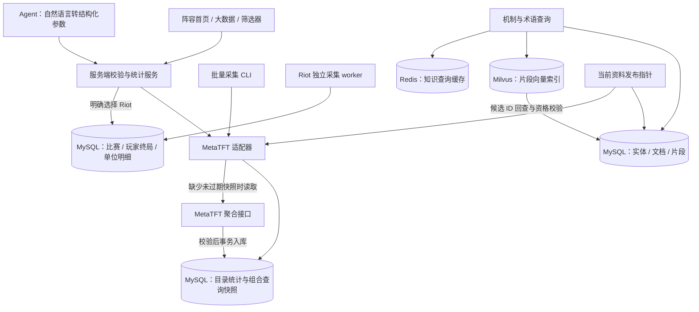

# V4 数据架构：现状、边界与整理方案

核验日期：2026-10-11。本文以运行中的 MySQL 和实际代码为依据，是当前数据库架构入口。历史设想见 RAG_ARCHITECTURE.md；其中尚未实现的表和流程不算本版能力。

后续更新：同日统计调度迁移 008 新增 `statistics_jobs`、`statistics_job_runs`、`statistics_reference_snapshots`，运行库已查得 25 表、8 次迁移。后台周期、路径注册表、Redis 统计缓存和前端版本检测见 [统计调度](STATISTICS_SCHEDULE.md)。下文 22 表的外键及孤立记录审计保留为迁移前基线，不冒充迁移后重新审计结果；“缺少持久采集批次表”已部分由任务执行历史解决，独立整批发布指针与归档清理仍未实现。

## 1. 审计结论

迁移 008 前的基线库有 **22 张表、7 次结构迁移、18 组外键**。当时只读一致性事务核验中，外键孤立记录为 **0**，7 份迁移文件均与数据库校验和一致。本次没有删表、清数据、合并历史来源或重建向量。

存在需要整理的设计债务：统计快照兼任查询缓存与审计归档；缺少持久采集批次表、独立统计发布指针及归档保留策略；统计依赖整个知识发布 ID；来源能力分散在发布包和适配器代码中。旧文档、旧运行状态还容易让人把历史 OP.GG 包误认为当前 MetaTFT 统计。后者已在本次修正。

核验文件：[结构与关系审计](DATABASE_ARCHITECTURE_AUDIT.json)、[MetaTFT 内容审计](METATFT_COVERAGE_AUDIT.json)、[段位接口验收](METATFT_RANKS_API_VALIDATION.json)。计数均附采样时间，后续浏览查询会增加快照数。

## 2. 当前运行架构



这仍是一个 Node 应用中的分模块架构，没有必要因为有多类数据就拆成多个微服务。MySQL 保存可追溯的业务事实与统计；Milvus 只负责知识片段检索；Redis 用于知识查询缓存和 Riot 限速协调，当前 MetaTFT 统计快照的缓存命中在 MySQL 完成。

数据库模式下，三个统计页面和 Agent 共用服务。单人本机 JSON 开发模式保留旧来源对照路径，与部署在 3001 端口的数据库版分开。个人阵容笔记仍存在浏览器 localStorage，不在 MySQL 或 Milvus 中。

## 3. 22 张表按职责分组

| 分组 | 物理表 | 行的含义 |
| --- | --- | --- |
| 结构与发布（4） | `schema_migrations`、`data_releases`、`runtime_state`、`change_log` | 迁移记录、不可变资料发布、当前指针、发布操作记录 |
| 实体与来源（4） | `entities`、`source_snapshots`、`snapshot_patch_assignments`、`source_capabilities` | 一个发布内的实体、来源包、独立补丁归档证据、发布时来源能力 |
| 知识与索引（4） | `knowledge_documents`、`knowledge_chunks`、`reward_branches`、`index_jobs` | 文档、可检索片段、结构化奖励行、向量索引任务 |
| MetaTFT 目录统计（2） | `metatft_datasets`、`metatft_dataset_rows` | 一个范围的一次采集；该快照里的整体榜单、阵容体系、三件套或携带者记录 |
| MetaTFT 组合查询（2） | `metatft_query_snapshots`、`metatft_query_rows` | 一组棋子/装备/持有者条件的一次上游结果；该结果的出装、队友、棋子组合记录 |
| Riot 对局（6） | `riot_matches`、`riot_participants`、`riot_units`、`riot_unit_items`、`riot_traits`、`riot_collection_jobs` | 比赛、玩家终局、上场单位、单位装备槽、激活羁绊、采集进度 |

MetaTFT 两类快照保留相同实体并不一定是重复数据。大龙整体、黄金大龙三件套、黄金“大龙在场且阿木木持有某装备”回答的是不同问题，应保留各自范围和分母。旧 OPGG/Tactics.tools 包和 Riot 数据不与它们相加，也不在 MetaTFT 失败时自动代替。

## 4. 已核验的库存，不能混用的计数

结构审计时间为 **2026-10-11 06:06:02 UTC**：

| 数据 | 实际计数 | 口径 |
| --- | --- | --- |
| 资料发布 | 3 | 保留历史发布，当前指针只有 1 个 |
| 当前实体 | 844 | 不等于英雄数，包含装备、羁绊、强化与赛季玩法 |
| 当前文档 / 片段 / 奖励行 | 832 / 940 / 846 | 三种不同业务对象 |
| 当前 Milvus 索引任务计数 | 869 | 本次读取 MySQL 索引任务，未重新逐条核验向量或调用 Embedding |
| 当前发布来源包 | 210 | 包含术语和静态来源；不是 MetaTFT 快照数 |
| MetaTFT 目录快照 / 统计行 | 2,584 / 390,604 | 当前发布的全部保留快照，包含旧适配器与已过期采集 |
| MetaTFT 组合查询快照 / 统计行 | 45 / 23,457 | 同一查询不同时间可能有多个快照 |
| Riot 比赛 / 玩家终局 | 87 / 689 | 全库留存数，不能直接当作当前可查询样本 |

本次全目录采集目标为 **2,556 个任务**：12 个段位范围 ×（74 个棋子/形态 + 137 件装备 + 整体统计 + 阵容体系）。装备目录为常规 39、光明 36、神器 31、纹章 21、散件 10。

其中 **2,555 份有效快照、383,152 条规范统计行、2,603 个原始响应体**已经回读核验，原始响应体共 69,444,927 字节；没有发现入库内容哈希或名次指标不一致。120 个任务得到没有可接纳统计行的结果，保留其实际返回情况。

仍有 **1 个失败任务**：全部段位的苍蓝雕纹魔像（`DA_Sentinel18`）出装接口持续 HTTP 500，两轮采集各重试后仍失败，因此完整采集验收为未通过。失败没有写成零样本。来源本身还限制候选组合数量，目录采集完成也不能称为取得所有可能组合或原始逐局数据。

整体榜单与目录详情数量也不同：当前可映射的整体统计为 65 个棋子、136 件装备、90 个羁绊档位；目录缺项显示“来源整体统计未返回”。上游额外的形态、召唤物、药剂等 ID 保存在原始响应，列入 `sourceUnmapped`，未经确认不猜测合并到另一个实体。

## 5. 查询键、版本与证据规则

`dataset_key` / `query_key` 是规范范围的哈希。范围包括资料发布、适配器版本、赛季、主补丁、B 补丁、模式、近 3 天窗口、段位集合、来源默认地区及实体或条件。相同参数顺序不应产生不同语义。持有者和重复装备数量属于条件，不能在归一化时丢掉。

段位提供 10 个独立档位，以及“铂金及以上”“全部段位”两个集合。单个黄金档不包含铂金；不同范围的统计不相加。上游必须回显相同段位集合且没有自动放宽，才会被接受。地区仍为来源默认范围，未实现地区筛选。

| 字段 | 当前含义 |
| --- | --- |
| 资料 `source_patch` | 静态规则资料自带的版本，本次为 18.4 |
| `runtime_state.current_patch` | 当前主补丁查询门槛，本次为 18.4 |
| MetaTFT `requestedPatch` | 本次明确请求的 18.4b |
| MetaTFT `sourceCurrentPatch` | 独立来源元数据返回的当前 18.4b |
| MetaTFT 统计 `sourcePatch` | null；统计响应未直接声明补丁，不能用请求值冒充 |
| 旧包 `assigned_patch` | 独立证据支持的推定归档，不改原始 `source_patch` |

目录快照保鲜 6 小时，组合查询保鲜 10 分钟。过期只表示不再作为新查询命中，**没有自动物理删除**。每次新结果先事务写入父快照和子记录，再从 MySQL 回读供页面与 Agent 使用。当前只在单个进程内合并并发相同请求，多进程之间没有采集锁。

资料发布期间，采集保存事务锁定当前指针并校验发布/补丁是否改变，防止旧目录结果以新发布身份入库。各来源端点独立更新时间仍可能造成数值小幅差异，并未实现跨所有统计端点的一致快照。

## 6. 为什么不能把所有统计放一张表后任意 JOIN

MetaTFT 给的是聚合结果。只有“带密银的大龙”和“带无尽的大龙”两行时，SQL 无法还原“同时带密银和无尽”的交集；它们可能来自重叠或不同玩家终局。不能连接后相加样本，也不能取较小分母当交集。

因此，已返回的具体三件套可以在本地筛选；新的多条件交集仍需要对应上游条件查询，并以完整条件保存快照。Riot 的逐局单位与装备表可以执行同一玩家终局关联，但其采样规模和来源必须单列。Milvus 也不能用相似的出装文字替代实际统计查询。

阵容首页是**体系聚类**，代表名单与装备只是来源示例；筛选器是**条件交集**；大数据整体榜是**实体整体表现**；出装详情是**已观测的具体三件套**。它们共用来源和服务，不共用一个被错误解释的指标。

## 7. 本次已经落实的整理

1. 提供只读 `audit-data-architecture.mjs`：一致性事务读取实际表、列、索引、行数、外键、迁移校验和和发布状态，输出可重复核验的 JSON。
2. 修正 `/api/storage` 及开发者资产页：历史发布包、MetaTFT 目录快照、组合快照、Riot 对局和 RAG 各自计数。旧 `statistics` 字段保留兼容，但明确其范围不含 MetaTFT。
3. MetaTFT 全目录按段位采集，光明与散件纳入目录；失败、空结果、未映射及来源限制留在报告中。
4. 去掉本地出装 30 条和筛选结果 60 条的截断，保留来源候选边界；补齐段位的请求、存储键、页面状态和 Agent 工具参数传递。
5. 将本文作为架构入口，标明历史文档的时间范围，避免把旧设计描述为当前实现。

以上没有引入破坏性迁移。源码、原镜像和修改前 MySQL 备份已保留，备份路径与校验值见工程学习记录。

## 8. 下一阶段目标模型（尚未实施）

按以下顺序渐进整理，保留旧读路径，先对照查询再切换：

| 顺序 | 建议新增或拆分 | 解决的问题与切换标准 |
| --- | --- | --- |
| 1 | `ingestion_runs`、`ingestion_tasks` | 把目标目录、成功/空/失败、重试、源错误和快照 ID 从单机报告提升为 MySQL 可恢复任务；失败重跑不覆盖上次批次记录 |
| 2 | `stat_scopes`、`stat_snapshot_heads` | 将来源、补丁证据、赛季、段位集合、队列、地区、窗口做成显式范围；统计头指向通过验收的快照，不靠“全库最大时间”判断当前数据 |
| 3 | `raw_response_blobs` + 快照响应关联 | 按内容哈希去重原始响应；保留端点、请求范围、时间和字节校验。目录实体名称、图片等展示字段由实体层关联，减少每行重复 JSON |
| 4 | 区分 `catalog_versions` 与知识发布 | 仅更新术语时不必使相同赛季目录统计全部失效；仍需通过目录映射哈希与版本契约隔离真正换版 |
| 5 | 导出清单、归档保留与清理任务 | 先统计容量并导出可校验归档，保留当前头与引用快照，试恢复通过后才实施清理；TTL 本身不能当作删除授权 |

目标范围表是统一元数据，不把 MetaTFT 体系、条件聚合和 Riot 原始比赛压成相同事实表。表粒度继续保持明确。JSON 保留原始差异，常用查询维度再实体化并添加组合索引；是否加索引先用真实查询计划与耗时决定。

来源能力也应迁入统一注册表，由同一校验器供页面与 Agent 使用，替代“发布包能力 + 代码能力”两套描述。接口继续参数化，Agent 只有经校验的领域工具，没有任意 SQL 权限。

验收新模型必须同时覆盖：同范围结果逐项相等、不同段位/补丁绝不串用、零样本与失败不混同、任务中断可恢复、旧页面兼容、来源原文哈希可回查、归档可恢复。当前尚未执行这组新表迁移，不能将此设计表述成已完成重构。

## 9. 维护入口

在项目 PowerShell 中执行以下命令，连接已有 Compose 服务。它们不调用聊天模型或 Embedding。采集会访问 MetaTFT 并写入 MySQL；两个 audit 只读数据库并写报告文件。

```powershell
$taskMount = (Get-Location).Path + ':/app'
docker compose --env-file .env.docker run --rm --no-deps -T -v $taskMount app node scripts/collect-metatft.mjs --apply
docker compose --env-file .env.docker run --rm --no-deps -T -v $taskMount app node scripts/audit-metatft-coverage.mjs
docker compose --env-file .env.docker run --rm --no-deps -T -v $taskMount app node scripts/audit-data-architecture.mjs
```

采集默认处理所有 12 个范围；可用 `--rank GOLD` 等限定范围。重复执行复用未过期 MySQL 快照；保留失败结果，不假装采集完整。若需要另做单范围诊断，使用独立 `--out` 报告路径，避免覆盖全批次报告。没有新增每日 MetaTFT 自动调度。

主要代码：`server/storage/` 管理发布和基础设施；`server/metatft/` 管理聚合统计；`server/riot/` 管理逐局明细；`server/knowledge/` 管理检索；`server/query-agent.mjs` 把自然语言工具请求送到页面共用领域服务。
