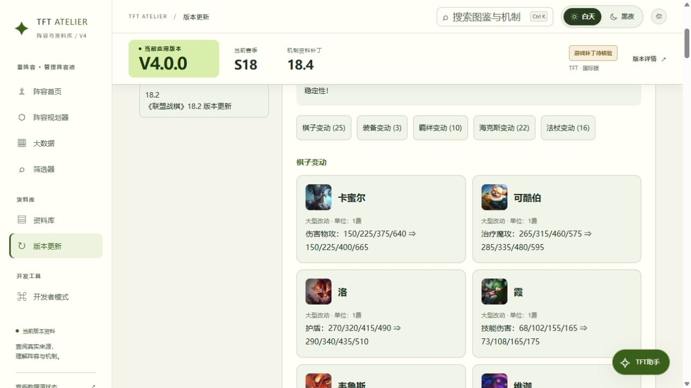
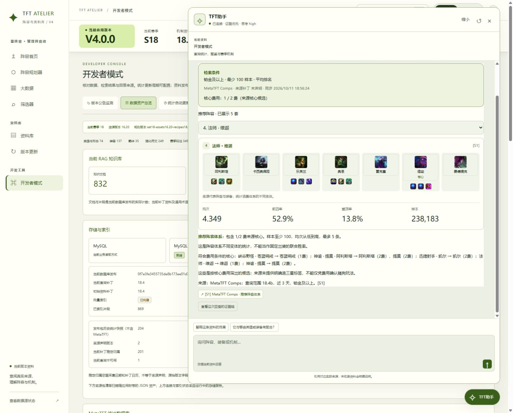
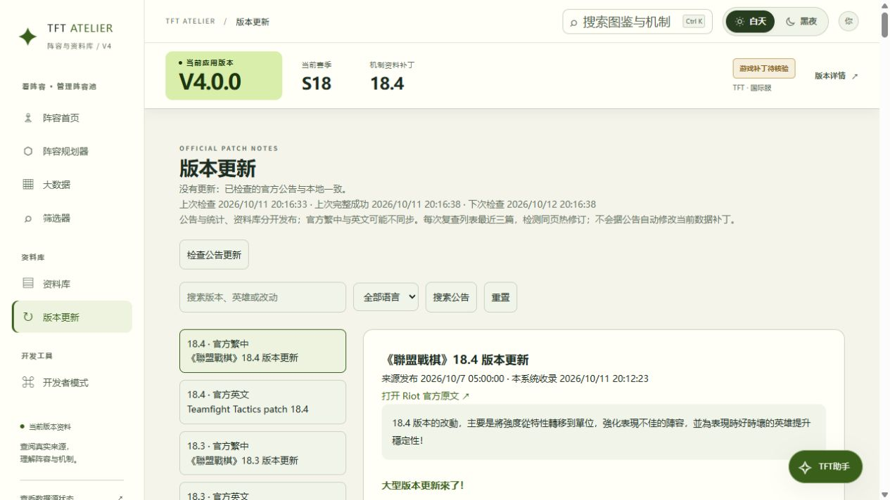
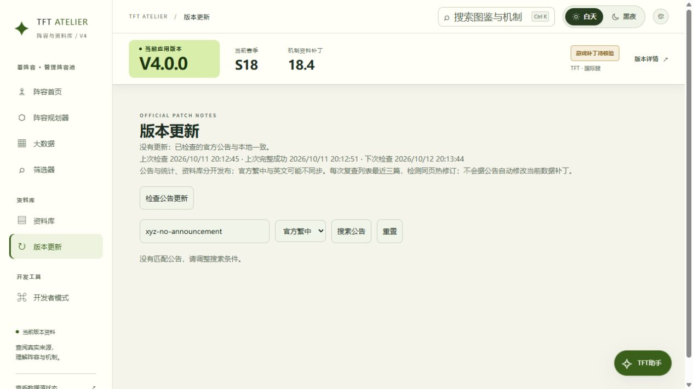
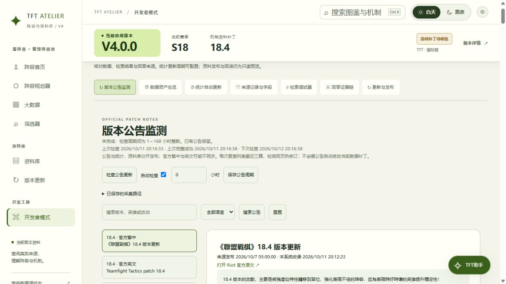
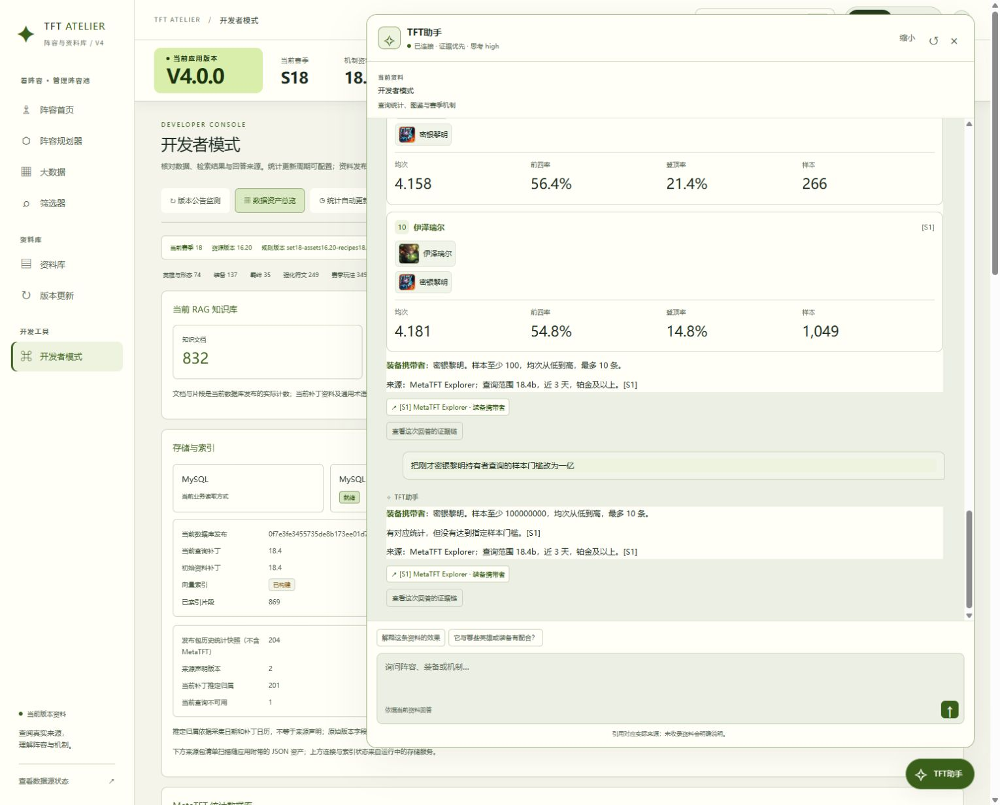

# 官方公告与聊天图文（2026-10-11）

## 当日后续升级：分类图文与双语

以下状态覆盖本文早期的“纯文字/6份正文”描述：公告现在默认展示棋子、装备、羁绊、海克斯、法杖五类图文卡片；可展开完整官方富文本和图片。简中来自官方繁中转简体（明确标注），英文来自官方英文源。版本页字体与语言保存在浏览器；不意味着整个应用已国际化。

读取仍使用 MySQL 已保存内容；进入版本页且上次检查超过5分钟会主动检查上游，也可点“检查最新公告”。后台默认24小时，可在开发者模式设置1～168小时。不是上游推送，不会每次渲染都采集。来源故障保留旧内容。

实体映射在 `data/patch-entities.json`，由 `scripts/build-patch-entities.mjs` 使用固定版本的 `data/raw/cdragon-{en_us,zh_cn,zh_tw}.json` 按 apiName 生成；目前S18、资产16.20，共846条映射，并非846条公告改动。换赛季需更新固定版本的三语言原始数据并重新运行该脚本。来源公告中无法匹配的项目保留说明，不使用近似图标。

最终测试463通过；MySQL实查6个URL、12份内容修订，其中6份新增修订是富文本升级。浏览器验收见 ENGINEERING_LESSONS.md 当日记录。初版与当前证据分开：

## 入口与运行方式

- 左侧「版本更新」：阅读、搜索、切换官方繁中/英文、手动检查。
- 「开发者模式 → 版本公告监测」：启停、设置1～168小时、查看采集路径、立即检查。最终配置启用24小时。
- 服务启动12秒后第一次检查到期任务，之后每60秒检查是否到期；实际外部抓取按保存周期执行。关闭应用/电脑时不运行，恢复后检查到期任务。周期从保存或任务完成时间计。
- 聊天右上「展开」进入宽视图；阵容通过下拉框切换。棋子和装备图标可点击查看资料。统计来自现有工具输出，不让模型生成数字。

## 官方路径与数据边界

- https://teamfighttactics.leagueoflegends.com/zh-tw/news/game-updates/
- https://teamfighttactics.leagueoflegends.com/en-us/news/game-updates/

路径白名单在 `server/patch-notes.mjs` 的 PATCH_SOURCES；开发者页面可查看，不接受任意外部 URL。列表发现文章后，保存各文章原文 URL。解析官方 NEXT_DATA 的公告正文，去除脚本与标签后通过 textContent 展示。未取得的图片不生成替代图。

每次检查每个来源最近三篇，保存 title/patch/locale/publishedAt/body/summary/contentHash/fetchedAt/url。正文或标题等变化才保存修订；再次检查相同内容仅更新监测状态。若官方撤销改动回到已有正文，更新该正文最后收录时间使其重新成为当前展示内容。历史表保留不同内容修订，不是每次请求的完整日志。

目前真实保存18.4、18.3、18.2中英文共6篇。英文18.4包含B补丁章节，页面标题依旧18.4，因此不通过标题自动宣布资料库/统计已同步18.4b。中文与英文可能不同步。公告与统计、RAG资料、Milvus各自管理；新公告不会自动改当前生效补丁。

## 接口与存储

- GET `/api/patch-notes`：当前每篇公告的最新正文及监测状态。
- POST `/api/developer/patch-check`，JSON `{}`：手动检查；运行中409、10秒内重复429。
- POST `/api/developer/patch-schedule`，JSON `{"enabled":true,"intervalHours":24}`：配置；非法参数400。
- MySQL迁移009：patch_monitor（持久配置/状态）、patch_articles（不同正文修订）；不删除旧表。
- changed/unchanged/partial/failed 分开显示；不把403/429/解析失败当没有更新，不清空旧公告，不绕过上游限制。

代码实际状态值为 `updated` / `unchanged` / `partial` / `failed`，初始 `not_checked`。普通阅读只查MySQL；手动/后台检查才访问Riot。管理接口继承本项目本机Host/Origin校验，不应直接作为公网无认证管理服务开放。

## 实际验收

- 自动化456/456通过，日志 `tmp/patch-chat-final-tests.log`；普通测试不调用付费模型。上游503保留旧内容为隔离测试，不是线上官方故障。
- 浏览器从侧栏进入版本页；输入无匹配关键词显示空结果；改语言/搜索18.4/选文章/重置/刷新能读取已保存公告。搜索包含正文，因此18.3正文提到18.4也可命中。
- 默认到期后台抓取新增6篇；多次手动检查均无变化。MySQL直接计数6个URL/6份不同正文，迁移9。
- 开发者保存1小时，再恢复24小时；部署重启后仍为24小时。输入0显示真实校验错误，原公告与原配置仍保留。
- 已打开旧JS页面在部署后发问成功；新页展开宽视图并切换到小法。密银黎明给谁返回持有者卡片；追问一亿样本门槛返回无合格样本，未混入上一轮卡片。
- 图文与公告不是对参考站的逐像素复制。参考站浏览器访问权限未获允许，依据用户提供截图实现。

证据：

备份：`tmp/patch-chat-backup`、Docker镜像 `tft-workbench:pre-patch-notes`。本次迁移只新增表，没有进行数据删除，也没有演练恢复。长周期运行、历史公告归档和来源HTML结构长期稳定性尚未验证。
