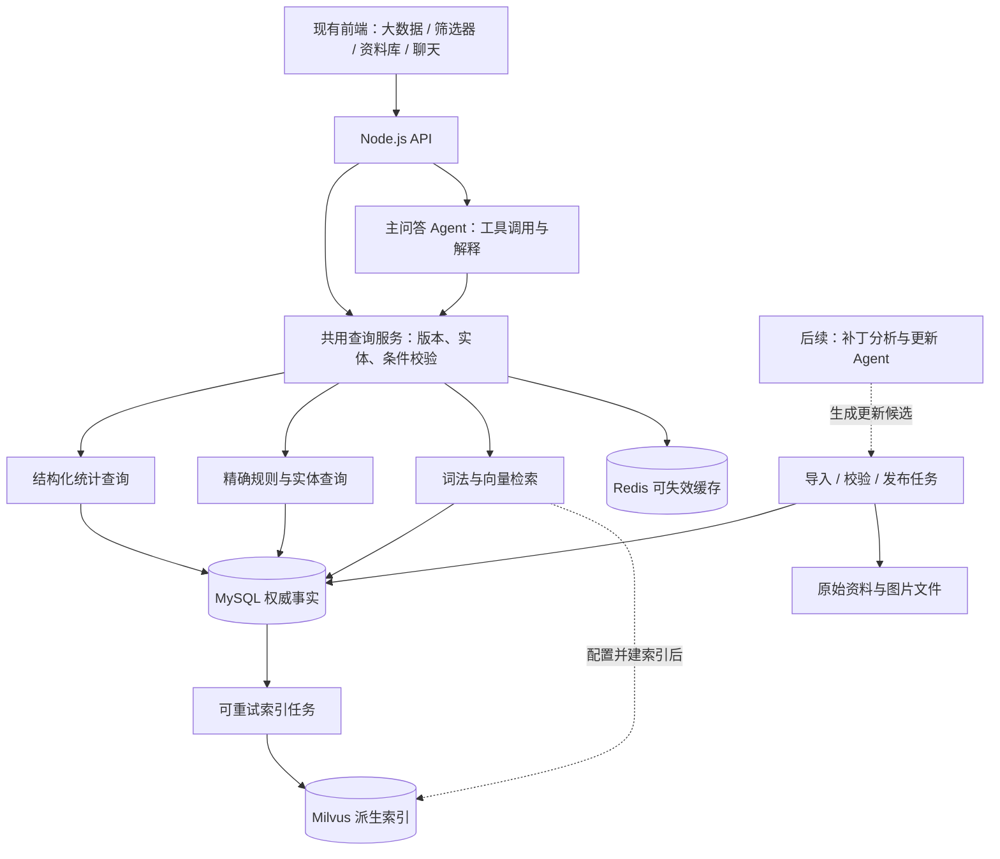

# TFT 数据与 RAG 架构

> 历史设计说明：本文件保留 2026-10-10 的目标与基础实施过程。2026-10-11 当前 22 张物理表、MetaTFT 统计数据流、实际审计与后续整理方案统一见 [V4 数据架构](DATABASE_ARCHITECTURE.md)。下文早期数量和待实施能力不能当作当前运行结果。

设计日期：2026-10-10。范围：电脑版《云顶之弈》当前赛季，个人 Docker 部署。本文区分已经确认的产品约束、目标架构和实施阶段；架构图不代表所有组件已经运行。玩家问题和验收要求见 [RAG_QUESTION_MATRIX.md](RAG_QUESTION_MATRIX.md)。

同日后续实现：Riot 终局采集、Redis 共享限流、MySQL 逐局表、每日 worker 及同一玩家条件查询已运行。筛选器与 Agent 共用服务，当前 36 场、288 份合格玩家终局；主补丁按比赛时间推定，热修未知。精确已实现范围与验收见 [RIOT_PIPELINE.md](RIOT_PIPELINE.md)。

## 1. 已确认的边界

- 保留现有前端及 Node.js API，逐步把 JSON 读取迁入数据库服务，不为技术栈展示重写为 Python。
- Agent 的第一职责是代玩家使用大数据、筛选器和资料库。装备结论必须来自真实统计，规则答案必须有可追溯证据。
- 筛选器交互参考 Tactics.tools 与 MetaTFT，一个搜索框持续添加条件，同时显示装备、队友、推荐阵容。无需先匹配或选择一个命名阵容。
- 统计按当前补丁查询。来源明确提供补丁，或 OP.GG 缺补丁但已有受审的当前补丁归档，均可返回；后者必须标注推定。低样本可展示并提醒，不自动放宽条件，不以明确旧补丁或边际统计补齐。
- 本地规则不足时允许联网补查，但联网内容与已核验资料区分。这是后续能力，不因设计了入口就声称联网工具已接通。
- 回答应显示版本、来源和可查看的图片／表格。图片展示、图片表解析、对局截图识别是不同能力；本阶段不加入自动对局截图识别。
- 模型采用可配置 API。第一阶段不检索个人阵容笔记，不训练本地模型。
- 提供本赛季初始知识数据包和 Docker 启动路径，随后由维护者提供经过核验的知识更新；数据包不伪装为实时数据。
- 每天同步统计、补丁更新分析、确定性校验后自动发布、疑难条目待审，是后续维护目标。每次发布保留变更记录。
- 运营复盘先预留案例模型，后续按局面、行动、理由、结果组织。比赛案例不与官方规则或胜率统计混成同一种证据。

## 2. 总体结构



MySQL 保存可恢复的正文、事实和发布状态。Milvus 可从这些记录重建；Redis 清空不应丢失知识。LLM 不直接执行任意 SQL，也不在每次筛选器点击时参与检索。

一个主问答 Agent 足够承担当前问答范围。路由是明确的任务分类和工具选择，不需要为英雄、装备、法杖分别创建 Agent。后台更新分析与在线问答的权限、预算和任务状态分开，但自动更新 Agent 属于后续阶段。

## 3. 数据源能力与当前缺口

现有本地资料可以导入，不需要从头采集：图鉴、中文机制专题、奖励表、法杖与海克斯条件、OP.GG 缓存和 Tactics.tools 整体统计均是导入对象。

| 当前来源 | 已有内容 | 不得据此宣称的能力 |
| --- | --- | --- |
| OP.GG 当前缓存 | 英雄装备组合、装备携带者、少量来源阵容；缺补丁可经受审策略推定归档 | 任意多英雄联合统计；推定补丁不能称为来源自报或保证全部样本仅该版；未提供段位不能认定为某段位 |
| Tactics.tools 整体快照 | 来源标记为 18.4、Ranked、Diamond+ 的英雄／装备聚合统计 | 不能把总体口径借给 OP.GG；不能从总体表恢复任意条件联合分布 |
| Riot 比赛 API | 已采集的普通排位玩家终局、棋子实例和装备；当前补丁内执行严格联合查询 | 样本规模小且有种子偏差，比赛时段位与热修未知；不能还原逐回合运营 |
| Little Buddy Bot 整理包 | 中文规则、奖励表、条件和图片证据 | 来源版本冲突或未核验条目不能参与当前数值问答 |
| 现有 10 套来源阵容 | 阵容名单、装备和来源统计 | 匹配方案数不等于匹配玩家对局数 |

`sourcePatch = null` 保留“来源未提供补丁”的事实。按用户本轮明确授权，OP.GG 统计可以依据原始采集日、官方日历和来源默认页面，通过受审策略另存 `assignedPatch` 并参与当前归档补丁查询；记录必须绑定发布、快照键与内容哈希，保留方法、证据和审计。明确来源补丁不符、或缺来源补丁且无有效归档时仍拒绝。日历和页面标记不保证统计窗口内全部样本仅属于该补丁，尤其切版日和 B 更新；资源版本 16.20 也不能充当统计版本。具体能力、归档与局限见 [OPGG_DATA_CONTRACT.md](OPGG_DATA_CONTRACT.md)。

任意组合查询有两条可行数据路径：取得支持相同条件语义的来源接口，或取得足够粒度的真实观测记录后自行聚合。现有单英雄榜和阵容榜不足以合成这种能力。对数据源的核查结论要进入能力表，前端和 Agent 共用该判断。

## 4. MySQL 逻辑模型

下列名称表达逻辑职责。实际物理表名以数据库迁移文件为准；未来模块列出的表不能理解为本轮已经实现。

### 4.1 版本、来源与发布

| 逻辑记录 | 关键字段 | 约束与索引方向 |
| --- | --- | --- |
| 游戏版本 | `game`, `set_id`, `patch`, `hotfix`, `effective_at`, `verification_status` | 补丁身份不能仅靠字符串大小比较；PC TFT 与金铲铲隔离 |
| 数据来源 | `source_id`, `name`, `url`, `capabilities`, `scope` | 能力区分总体统计、单英雄完整出装、条件联合统计、规则说明 |
| 采集批次 | `run_id`, `source_id`, `fetched_at`, `source_patch`, `content_hash`, `status`, `error_code` | 原始捕获时间不能在重复导入时重写成现在 |
| 统计补丁归档 | `release_id`, `snapshot_key`, `content_hash`, `assigned_patch`, `attribution` | 保留来源空值；推定绑定原快照及采集窗口，有证据和变更审计 |
| 发布批次 | `release_id`, `set_id`, `patch`, `status`, `manifest_hash`, `published_at`, `previous_release_id` | 内容不可变；重复导入同一哈希保持幂等 |
| 活跃发布指针 | `channel`, `release_id`, `generation` | 在事务中切换；统计与知识可有各自批次，但查询必须显式绑定 |
| 审核和变更记录 | `target_id`, `reason`, `before_hash`, `after_hash`, `reviewer`, `reviewed_at` | 自动校验通过与人工审核必须可区分 |

知识适用版本与来源原始版本分开保存。确认一个规则跨补丁未变化，可以发布新适用关系，但要留下核验依据；不能对统计执行同样的版本继承。

### 4.2 游戏实体与规则

| 逻辑记录 | 关键字段 | 用途 |
| --- | --- | --- |
| 实体 | `entity_id`, `set_id`, `kind`, `source_native_id`, `name_zh`, `name_original`, `icon_uri` | 英雄、装备、羁绊、海克斯、法杖和法球的统一身份 |
| 别名与来源映射 | `entity_id`, `normalized_alias`, `language`, `source_id`, `mapping_status` | 小法／维迦／英文名对齐；歧义不直接选一个 |
| 实体版本内容 | `entity_id`, `release_id`, `payload`, `source_ref` | 技能、费用、属性等随补丁改变的字段 |
| 规则 | `rule_id`, `entity_id`, `release_id`, `rule_kind`, `conditions`, `effect`, `exceptions`, `evidence_ref` | 条件、效果和例外作为一个可追溯单元 |
| 奖励组与分支 | `rule_id`, `condition_group`, `branch_id`, `probability`, `reward_payload`, `exhaustive`, `denominator_scope` | 保留完整随机分支和概率分母 |
| 关系 | `from_entity_id`, `to_entity_id`, `relation_type`, `conditions`, `evidence_ref` | 合成、升级、互斥、触发与相关条目 |

条件结构应能够表达 `all`、`any`、比较运算以及未知值，例如“阶段满足且金币不足某值”。不是所有自然语言条件都能立即程序化：原文与中文说明必须保留，尚未结构化的部分标记为不可自动判定。不能把“资料未记载互斥”转换成“明确兼容”。

### 4.3 文档、切片与媒体

| 逻辑记录 | 关键字段 | 用途 |
| --- | --- | --- |
| 源文档 | `document_id`, `release_id`, `title`, `body`, `entity_refs`, `source_url`, `source_patch`, `review_status`, `eligible` | 权威正文、结构化表格和证据引用 |
| 知识片段 | `chunk_id`, `document_id`, `release_id`, `chunk_kind`, `text`, `payload`, `entity_refs`, `ordinal`, `content_hash`, `chunker_version` | 检索入口及确定性还原 |
| 原始媒体 | `asset_id`, `uri`, `mime_type`, `sha256`, `source_url`, `captured_at`, `caption`, `review_status` | 图片展示、原图追溯；不是只存外链 |
| 索引任务 | `job_id`, `release_id`, `chunk_id`, `embedding_profile`, `state`, `attempts`, `error`, `indexed_at` | 重试、重建和覆盖率检查 |

关键组合索引是发布／补丁／资格与文档 ID、实体 ID、片段 ID 的组合。JSON 适合保留来源结构与尚未标准化条件；经常用于筛选、排序、去重、连接的字段应独立成列，不能把整个查询服务退化成读取 JSON 全表扫描。

### 4.4 统计

聚合来源表至少保留：`dataset_id`、真实 `source_patch`、`mode`、`region`、`rank_scope`、统计窗口、采集批次、指标定义、实体／出装组合、样本量及样本单位。未知字段保持空值；经批准的补丁推定另存 `assigned_patch` 与归档证据，不能覆盖原 `source_patch`。完整三件套用排序后的多重集合建立组合键，保留重复装备数量；不能把单件榜前三项拼成观测三件套。

现已为 Riot 建立比赛、玩家终局、棋子实例、装备槽与羁绊记录。所有选中英雄必须属于同一玩家的同一局终局观测，不能只按比赛 ID 连接到同局其他玩家；装备绑定到同一英雄实例。SQL 在只读一致性事务内执行。当前仅覆盖最终棋盘，不提供某回合棋盘、备战席或比赛时段位筛选。

结果状态需要区分：

- `unsupported_query`：来源不支持这种筛选。
- `not_ingested`：存在采集能力，但尚未入库。
- `source_patch_unknown`：来源补丁未知，且没有有效的受审补丁归档。
- `patch_unavailable`：当前补丁无可用发布。
- `sync_failed`：采集或发布失败。
- `empty`：支持该查询、数据有效，且真实零匹配。
- `ready`：有结果；低样本提示是结果属性，不应自动改为无结果。

这些是接口语义约定，具体实现可以用统一状态加原因码，但不能丢掉上述差别。

## 5. 切片方案

切片首先按资料结构，长度限制只用于防止单段超出模型输入。一个版本内的原始事实不得因检索方便而被改写成更强的断言。

| 资料类型 | 片段边界 | 必須带回的上下文 |
| --- | --- | --- |
| 英雄／装备实体说明 | 一个实体的一个独立主题 | 名称、形态、当前效果和来源 |
| 海克斯／法杖条件 | 一个实体的完整出现条件 | 阶段、模式、前提、冷却、互斥、例外；区分出现、购买和效果触发 |
| 奖励表 | 同一触发条件／档位的全部分支 | 表头、奖励数量、概率、分母、说明和脚注 |
| 商店概率等规则表 | 能独立回答一个条件的行组 | 等级／阶段、列名、单位、脚注 |
| 长机制说明 | 标题下一个完整论点或步骤组 | 父标题、适用条件、相邻必要解释 |
| 图片资料 | 核验后的结构化行组 | 原图引用、识别／映射核验状态 |
| 后续运营案例 | 一个决策事件 | 局面、备选行动、选手理由、实际结果及证据性质 |

奖励切片示例（结构示意，非新增游戏事实）：

```json
{
  "chunkKind": "reward_condition_group",
  "entityRefs": ["augment:trait-ladder"],
  "condition": { "activeTraitCount": 6 },
  "branches": [
    { "id": "source-branch-a", "probability": 0.5, "rewards": "来源核验后的奖励列表" },
    { "id": "source-branch-b", "probability": 0.5, "rewards": "来源核验后的奖励列表" }
  ],
  "exhaustive": true,
  "denominatorScope": "该六羁绊奖励档位内部",
  "footnotes": ["保留来源限制"],
  "sourceRef": "原文和图片引用"
}
```

原有 Trait Ladder 不同位置存在补丁标签冲突，这个例子只说明如何保持分支完整，不代表该条已获得当前版本检索资格。

片段 ID 需要由内容身份和内容哈希确定；同一输入重复切片应生成相同结果。更新后的片段属于新发布批次，旧片段不就地改写。检索子片段命中后，可按父文档补全必要上下文，但必须限制同一发布与同一资格范围。

## 6. 向量化与 Milvus

向量输入使用实体名称、别名、标题、适用条件与片段正文。图片 URL、哈希、审核状态等同时作为独立元数据保留。向量化不是 OCR，也不生成原本缺失的事实。

建议的集合字段：

| 字段 | 作用 |
| --- | --- |
| `chunk_id` | 确定性主键，与 MySQL 片段关联 |
| `release_id`, `set_id`, `patch`, `eligible` | 检索前过滤 |
| `document_id`, `entity_refs`, `chunk_kind` | 实体与主题限定 |
| `content_hash`, `embedding_profile` | 检测过期索引与模型身份 |
| `dense_vector` | 语义检索向量 |

一个 embedding 配置需要明确提供商、模型、维度、归一化方式及输入模板版本。未配置模型时只提供词法检索，当前接口返回 `retrieval.mode: lexical`；不调用假的向量函数，也不展示虚构相似度。

模型更换或维度变化采用新集合／新索引配置，验证覆盖率与问答集后切换。不能在一个向量空间混入不同模型向量。通过向量 API 返回成功不等于整批可检索，应验证条数、内容哈希、实际检索和版本隔离。

Milvus 支持搜索前按元数据限制候选范围；本项目用发布、补丁和资格作标准过滤，并在返回后查询 MySQL 再次确认记录仍有效。这样撤回或过期向量不会因为索引清理延迟成为回答证据。[Milvus 过滤检索文档](https://milvus.io/docs/filtered-search.md)

## 7. 查询访问与 Agent

### 7.1 公共查询层

前端与 Agent 共用三类领域服务：

1. `queryStatistics`：解析并校验条件，检查来源能力，限定当前补丁，执行真实统计查询。
2. `getEntity / getRules`：按规范实体 ID 读取图鉴和结构化规则，数字直接从事实读取。
3. `searchKnowledge`：为解释性问题查找证据，返回片段、图片、来源、版本和检索模式。

接口名是领域职责，不限定最终函数命名。输入不允许浏览器提交一个胜率让 Agent 直接相信；服务端必须重新查询指标。所有条件经过允许列表验证，数据库使用参数化查询。Agent 不能获得任意 SQL 执行能力。

### 7.2 知识检索流程

1. 标准化中英文输入并解析已知别名；有歧义则保留候选，必要时只问一个澄清问题。
2. 服务端决定活跃发布和当前补丁，得到符合资格的候选范围。
3. 对精确实体／规则问题优先走结构化读取；解释性问题并行执行词法检索与已配置的向量检索。
4. 将两路排名用 RRF 融合，避免直接相加不同量纲的分数。RRF 是排名合并，不是事实可信度。[Milvus RRF 文档](https://milvus.io/docs/rrf-ranker.md)
5. 回查 MySQL 片段，验证发布、补丁、资格及内容哈希；去重后补充必要父文档内容。
6. 把证据交给模型，答案引用事实 ID／来源和版本；证据不足时说明具体缺口。

可选 reranker 应在有评测证明收益后加入，本轮不默认依赖。没有统一的“相似度大于 0.85 就是真”的阈值；高语义相似但补丁错误的内容必须先被过滤。

### 7.3 连续追问状态（后续完整接入）

建议保存结构化状态：`state_version`、`patch`、`mode`、`rank_scope`、`region`、`conditions`、`target_entity_id`、`sort`、`sample_warning_policy`。条件中的装备要保留佩戴者或任意佩戴者语义。

后续话语转换为明确操作：添加条件、删除条件、更换目标、修改排序或清空。每次操作都重新校验并调用共用查询服务。不要仅凭完整聊天历史重新猜条件，也不要让模型把样本量和答案正文写回筛选状态。跨补丁后应提示重新查询，旧对话不能锁死旧版统计。

## 8. Redis 与一致性

缓存采用 cache-aside：查询先读 Redis，未命中时读权威服务，随后回填。Redis 故障时可直接读 MySQL，不能把不可用的缓存解释成没有知识。[Redis cache-aside 文档](https://redis.io/docs/latest/develop/use-cases/cache-aside/)

查询缓存键至少包含数据类型、活跃发布 ID、补丁、规范化条件哈希及索引配置。统计还需包含实际模式／段位／地区。发布切换后新 ID 自然形成新缓存空间，旧键按 TTL 清理。TTL 负责容量和更新频率，不能代替补丁校验。

暂不将模型自由文本作为长期事实缓存。后续会话状态可以放 Redis，但持久数据、导入进度和发布记录应存在 MySQL。个人笔记仍按现有存储方式运行，迁移到服务端属于独立阶段。

## 9. 首次导入、更新与发布

### 首次导入

1. Docker 服务健康后执行数据库迁移。
2. 读取项目现有版本包、校验哈希、验证结构和实体映射。
3. 事务导入实体、来源、正文、结构化事实、片段和统计记录；记录导入摘要。
4. 对冲突、未审知识资料保留原文和原因，禁止参与当前数值回答。统计缺补丁时可应用用户批准且满足采集窗口与内容哈希约束的归档策略；没有有效归档或明确来源版本不符仍拒绝。
5. 发布可用词法知识批次；如配置 embedding，则执行可重试索引任务并记录覆盖率。
6. 页面展示实际版本和最后采集时间。没有当前补丁统计时保持缺失，不把初始包的历史数据标为今日数据。

仅在无目标批次或批次内容哈希变化时导入；重复启动不重复插入，不覆盖用户配置或笔记。公开种子包范围需逐来源确认，第三方缓存技术上可读不等于默认允许随 GitHub 再分发。

### 发布一致性

MySQL 为权威，导入与切片先写候选批次。词法检索可在候选通过校验后发布，向量索引状态单独声明；若部署要求“发布即完整混合检索”，则必须等待索引覆盖验证后再切换活跃指针。两种模式不能静默混淆。

发布后的 dense 查询只使用标记完成的对应索引；索引不完整则整次请求明确降级为词法，不能仅召回已建索引的一小部分而自称完整混合检索。失败任务可按同一内容哈希重试。回滚切换发布指针并记录原因；统计回滚不能绕过当前补丁隔离。

### 后续更新管线

固定任务执行每日统计采集及公告检查。更新 Agent 读取公告和差异，生成受影响实体、候选修改、证据与更新任务；确定性程序进行字段、概率、ID、版本、重复和完整性校验。图片识别不确定、名称歧义、来源冲突进入待审列表。Agent 无权自由推断并改写数值或来源补丁；缺补丁统计的推定归档只能按已批准策略执行，单独记录证据与审计，不把旧快照按运行当天重贴版本。

后续发布日志应列出新增／修改／撤回条目、影响范围、来源、校验结果、审核类型和失败原因。更新 Agent、自动日程、审核 UI 和线上更新包分发需要单独交付验证，本轮基础建设不代表它们已启动。

## 10. 运营案例扩展

以后单独增加案例、决策事件、局面状态、候选行动、作者解释、结果和视频时间点。存明“选手本人解释”“整理者推断”“模型分析”，避免混淆。检索首先限定版本与局面特征，再查询语义近似案例。缺少当时血量／经济／棋盘等必要信息时不做确定结论。

案例库与 RAG 使用 API 模型即可运行；本地模型微调不是入库前置条件。微调是否值得引入，取决于独立评测是否显示稳定收益，不能仅因资料数量增长就启动训练。

## 11. 分阶段交付和验收

| 阶段 | 交付范围 | 完成证据 |
| --- | --- | --- |
| A：本轮基础 | 数据模型、迁移、已有资料幂等导入、结构化切片、检索与状态接口、数据库／缓存／向量连接边界、Docker 配置 | 单元与集成测试；真实连接若不可用必须单列，不将 mock 测试当实际部署成功 |
| B：向量质量 | 配置实际 embedding 模型、索引全部合格片段、验证 RRF 检索、基准评测、覆盖率与延迟观测 | 真实索引任务记录和问题集评测；没有密钥时仍是 lexical 模式 |
| C：统计能力 | 核验新来源、每日入库、当前有效补丁归档下的条件查询；推定状态透明，支持多少条件由真实来源决定 | 同口径对照查询、零样本与不支持区分、前端／Agent 一致 |
| D：维护闭环 | 定时任务、更新 Agent、审核与发布 UI、公告、维护者更新包分发 | 可重试任务、一次真实变更发布与回滚、消费者更新验证 |
| E：运营与个性化 | 运营案例、个人笔记检索及必要的局面输入 | 来源可追溯、案例与规则分离、独立问答评测 |

不能把已有图鉴全部可展示等同于全部知识已经向量化；不能把 Docker Compose 配置通过等同于所有容器启动成功；不能把库表设计完成等同于任意条件统计已有数据。

最低验收项：重复导入不增殖、冲突条目不用于当前数值回答、明确非当前补丁或无有效归档的未知补丁统计被拒绝、受审推定保留来源空值与证据、奖励组切片不丢分支、Milvus 过期结果被 MySQL 拦截、缓存不跨发布复用、未配置 embedding 如实返回词法模式、真实服务故障有可区分状态。完整场景见问题矩阵。

## 12. 本轮代码落点

本节描述基础实现与前述完整目标模型的对应关系。表和命令已经有实现，不代表当前机器已完成真实数据库导入或真实向量索引；实际执行结果应以命令输出、健康状态和交付验证为准。

### 12.1 初期基础阶段的 12 张物理表（历史记录）

迁移文件为 `server/storage/schema.sql` 和 `server/storage/schema-002.sql`，由 `server/storage/repository.mjs` 执行。

| 表 | 本轮职责 |
| --- | --- |
| `schema_migrations` | 数据库结构版本及迁移校验和 |
| `data_releases` | 不可变导入批次、赛季、来源补丁、清单及发布状态 |
| `runtime_state` | 当前补丁与活跃发布指针 |
| `source_snapshots` | 原来源聚合包、内容哈希、来源补丁与证据类型 |
| `snapshot_patch_assignments` | 与原快照内容哈希绑定的推定补丁、策略与证据；不改原来源补丁 |
| `entities` | 发布内的实体、名称、别名和原实体字段 |
| `knowledge_documents` | 原专题、海克斯规则、法杖条件、资格及来源 |
| `knowledge_chunks` | 确定性片段、正文、条件表组、实体引用和内容哈希 |
| `reward_branches` | 原表逐行奖励／规则记录和概率；条件组仍可由原结构恢复 |
| `source_capabilities` | OP.GG、整体统计、羁绊统计、机制资料各自支持的查询 |
| `index_jobs` | 每个发布和 embedding 配置的索引状态与数量 |
| `change_log` | 导入发布与统计补丁归档的变更记录 |

`source_snapshots` 保留来源聚合包；Riot 真实逐局记录另外保存在六张 `riot_*` 表中，使用迁移 003/004，未从聚合快照反造对局。筛选器支持已采集的玩家终局联合条件，来源不混合。独立审核工作流、运营案例与完整查询会话表仍属后续模型。

### 12.2 代码与接口

| 入口 | 作用与限制 |
| --- | --- |
| `server/storage/seed.mjs` | 从已校验的本地版本包构造导入批次、统计资格及来源能力 |
| `server/storage/repository.mjs` | 参数化 MySQL 读写、迁移、事务发布、活跃批次和合格片段读取 |
| `server/storage/runtime.mjs` | 选择 MySQL／本地后端、统计补丁隔离、Redis cache-aside 与健康状态 |
| `server/storage/patch-attribution.mjs` | 校验受审归档策略、绑定原快照并记录审计，来源明确补丁优先 |
| `server/knowledge/bundle.mjs` | 把专题、海克斯出现规则、法杖出现条件转换为文档；保留审核资格 |
| `server/knowledge/chunking.mjs` | 保持奖励条件组完整，生成稳定内容哈希和片段 |
| `server/knowledge/service.mjs` | 当前发布检索、词法排序、可用时的 dense 检索和 RRF、证据输出 |
| `server/knowledge/vector.mjs` | 独立 embedding API 配置、返回向量校验及 Milvus REST 适配 |
| `POST /api/knowledge/query` | 接受 `query`、可选 `entityId` 和 `limit`，返回证据、版本与实际检索模式 |
| `GET /api/storage` | 报告存储后端、服务连通性、embedding 配置和索引状态 |
| Agent `search_knowledge` 工具 | 将知识证据接入现有问答工具；精确规则路径和统计工具仍独立 |

Milvus 当前物理字段为 `id`、`release_id`、`source_patch`、`eligible` 和 `vector`；模型身份体现在集合及索引任务中，实体范围在权威候选回查时限制。第 6 节中的更多元数据字段属于扩展设计。

### 12.3 导入与索引命令

```powershell
npm run db:dry-run
npm run db:bootstrap
npm run rag:index
```

`db:dry-run` 只校验和汇总本地资料，不连接 MySQL。`db:bootstrap` 执行迁移和幂等导入。`rag:index` 要求 MySQL 和 Milvus 可用，并单独提供 `EMBEDDING_BASE_URL`、`EMBEDDING_API_KEY`、`EMBEDDING_MODEL`、`EMBEDDING_DIMENSIONS`；不复用聊天模型密钥、不生成占位向量。

当前种子资料的一次实际构建得到 844 个实体、641 份文档、749 个片段；其中 596 份文档与 678 个片段符合种子来源补丁 18.4 的资格。原始输入包的 209 份来源快照中有 204 份统计快照：2 份有匹配补丁，202 份 `sourcePatch` 为空，这是保留不变的来源事实。后续经用户授权，201 份可用 OP.GG 快照已另行推定归档为 18.4，另 1 份仍为 `not_supported`；没有把原始空值改成来源自报版本。实际恢复记录见 [STATISTICS_ATTRIBUTION_VALIDATION.json](STATISTICS_ATTRIBUTION_VALIDATION.json)，证据性质和采集窗口限制见 [OP.GG 合同](OPGG_DATA_CONTRACT.md)。这些数量不是当前线上游戏版本的独立判定。

本轮保留词法可用路径；真实 embedding、真实 Milvus 全量索引及检索质量必须在填写独立配置后另外验证。没有自动日程、更新 Agent、联网补查、完整多轮条件状态或运营训练的运行承诺。
