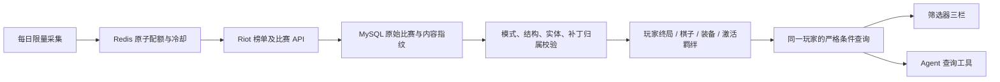

# Riot 比赛采集、入库与联合查询

更新：2026-10-10，Australia/Sydney。已在本机 Docker 验收，原首页和知识库继续运行。

## 已实现的链路



新增六张表：`riot_matches`、`riot_participants`、`riot_units`、`riot_unit_items`、`riot_traits`、`riot_collection_jobs`。迁移 003 创建表，004 增加保留数值序列化的原始 JSON 文本；已有数据库自动迁移，原知识库及 OP.GG 快照保留。

- 比赛 ID 为去重键；同一比赛同一内容重复导入不增加样本。内容改变则隔离，并记录新旧指纹，不静默替换。
- 一个 participant 表示一名玩家在一场比赛中的终局。英雄、装备和羁绊条件全部在这个范围内匹配。
- 装备绑定持有者时，必须在同一个棋子实例上满足所有装备条件；不能把两只小法的装备凑成一个出装。
- 同一玩家重复拥有相同英雄与相同三件套，在该出装分组只计一次。队友也按玩家终局去重；不同分组的样本可能重叠，不能相加当作总人数。
- 阵容按完整终局棋子名单分组，保留重复棋子数量；聚合不区分星级，不把某一条样本的装备或站位当作整个阵容的统一配置。
- 查询在只读一致性事务内完成，采集写入不会使三栏使用不同时间的样本范围。SQL 使用参数绑定，限定当前主补丁、赛季和普通排位 1100。
- 当前不缓存 Riot 聚合查询结果；Redis 用于共享限流，原知识检索缓存继续使用 Redis。

## 版本和缺失信息

实测 `game_datetime` 为结束时间，`gameCreation` 为开始时间；没有后者时，用结束时间减时长并标记依据。不能直接把采集日期当比赛版本。

当前原始 `game_version` 是占位字符串，`source_patch` 保持 null。官方补丁日历和 OP.GG 当前默认主补丁一致时，记录独立 `assigned_patch`：保守窗口从计划日期 UTC 零点后 36 小时开始，到核查时刻结束；它是推定边界，不是已核实的韩服生效时间。比赛开始和结束均须位于同一个窗口。窗口冲突、新的非占位版本格式、换版过渡期或未知归属进入隔离，绝不套用采集日版本。

韩文官方 18.4 公告有 10 月 8 日热修，并说明 PC 与移动端更新时间不同。因此页面显示“18.4 · 推定”，热修保持未知；不能称 18.4B 的精确样本。[官方公告](https://teamfighttactics.leagueoflegends.com/ko-kr/news/game-updates/teamfight-tactics-patch-18-4/)

每轮采集先更新窗口；核查失败仍可保存比赛，但不猜版本。下次成功核查后，从 MySQL 的原始比赛重新分类（每轮最多 250 条、较新比赛优先），无需重复花费 Riot 配额。窗口及当前应用补丁独立：发现新补丁不自动把旧赛季知识或快照标成新版本。

未知装备 ID 保留并列入开发者面板；包含它的棋子不能参与“完整合法三件套”排名，其余已识别棋子的记录仍可查询。原始比赛内玩家标识仅留在本机数据库，公共状态和统计结果不输出玩家标识、比赛 ID 或凭据。

## 采集与定时任务

开发 Key 在本机 `.env.docker` 的 `RIOT_API_KEY` 中填写。当前只支持 KR / ASIA 路由。Redis 使用服务器时间和原子 Lua 统一限制 20 次/秒、100 次/120 秒，默认请求至少间隔 1350ms；失败请求也占额度。Redis 不可用时停止上游请求。429 按 Retry-After 共享冷却并结束本轮，401/403 停止，均不在本轮自动重试。

MySQL 的命名锁防止多个采集任务并行执行，游标与待采比赛逐页、逐场持久化。下次从待采列表继续；数据库已有比赛跳过详情请求。首轮取种子玩家近 48 小时，后续采用完成时间游标并重叠 1 小时去重。榜单种子有选择偏差，不能把所有对手称为王者或用现在段位代替当局段位。

Windows 一键启动（包含原 RAG 服务）：

```powershell
.\start-docker.ps1 -Rag -Riot
```

只启用已构建镜像中的 worker：

```powershell
docker compose --env-file .env.docker --profile riot up -d --no-deps riot-worker
```

首次启动立即运行一轮，之后默认每 24 小时最多取 25 场详情。可在 `.env.docker` 调整 `RIOT_COLLECTION_INTERVAL_HOURS`（1–168）、`RIOT_COLLECTION_MAX_MATCHES`（1–100）、`RIOT_COLLECTION_SEEDS`（1–10，默认 3），重建 worker 容器后生效。下一次运行时间和错误状态保存在 MySQL，重启不会重新计算为立即采集。更新 Key 后也需要重新创建 worker 容器。

手动补采：

```powershell
docker compose --env-file .env.docker exec -T app node scripts/collect-riot.mjs --allow-provider --max-matches=50 --seed-count=10
```

仅暂停自动采集：

```powershell
docker compose --env-file .env.docker --profile riot stop riot-worker
```

开发 Key 会在 24 小时后失效，需要用户续期；worker 不会自动生成新 Key。长期开源运行还需安装者自行配置适合用途的凭据。旧 `probe-riot.mjs` 仍是单进程字段探针，不应与正式采集器共用同一个 Key 并发运行。[Riot Key 说明](https://developer.riotgames.com/docs/portal#api-keys)

## 页面与 Agent

`POST /api/research/query/v2` 返回 `schemaVersion: 2`，输入 `conditions`、可选 `carrierId`、`minSample`、`sort`。`carrierId` 必须是已选英雄，控制装备栏显示谁的出装；每个装备条件的 `holderId` 独立控制谁必须佩戴它。比如可以限定塔里克带棘刺背心，但查看同一阵容中德莱文的出装。

旧 `/api/research/query` 返回 HTTP 409 / `CLIENT_UPDATE_REQUIRED`，让仍然打开的旧页面显示刷新提示。旧页面只认识来源阵容的 `deckIds`，无法正确展示 Riot 的玩家终局统计，不能给它们混用新版数据。静态资源已设 `no-store`，但它无法替换浏览器中已经执行的 JS 模块；用户刷新后从 URL 恢复原筛选条件。

Riot 的 `minSample` 是提示阈值，低于阈值仍显示实际结果。返回平均名次、前四率、登顶率及该组合真实玩家终局样本数。各栏最多显示排序后的 100 个分组，并返回完整分组数；不截断参与计算的匹配对局。

当前补丁已有可用 Riot 比赛时，筛选器固定查询该来源；零命中保持为空，不回退 OP.GG 或放宽条件。尚无 Riot 合格数据的新安装保留原来源能力边界。首页及大数据详情仍使用原有聚合来源，指标不与 Riot 混合。

Agent 新增 `get_research_stats` 工具，筛选器上下文和明确多英雄统计问句使用同一服务；自然语言不明确时仍需澄清条件，尚未实现所有多轮增删与否定语义。不能把“这批样本中均次最低”称为全局最优。`GET /api/riot/status` 及开发者面板展示入库、可查、隔离、映射缺口和下次运行时间。

## 本轮验收

2026-10-10 本机：原 12 场加手动 50 场及 worker 首轮 25 场，共 87 场；36 场当前可用，288 份玩家终局，其余 51 场隔离。初始例子的三英雄与持有者条件已按原始 JSON 逐条比对；扩充后样本可能变化，详见带时间的 [验证记录](RIOT_PIPELINE_VALIDATION.json)。

- 全套自动化 330/330 通过，无跳过。测试仅使用离线或本机资源，没有付费模型调用。
- 真实 MySQL 9 项边界检查通过，测试行只存在于未提交事务，回滚后 0 条残留；命令 `node scripts/check-riot-query.mjs`。
- 真实 Redis 4 项检查通过，随机测试命名空间已清理；命令 `node scripts/check-riot-redis.mjs`。没有调用 Riot。
- 87 场完整重放第二遍全部判为重复，样本数不变；87 份原始 JSON 文本已留存。
- Agent 真实数据库检索预览成功，但未再调用付费聊天模型生成回答。
- 浏览器验证三栏、目标英雄切换、小样本提示、开发者状态。原首页 10 套阵容和 Milvus 678 个片段仍可用。

仅建立了统计闭环，当前样本仍很小；未提供当局段位、逐回合棋盘、星级筛选或可靠的稀有条件全量覆盖。Riot worker 不负责同步 OP.GG、重写知识或跨赛季发布。
